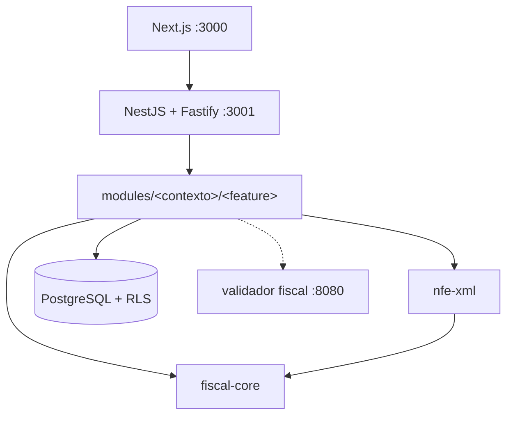

# MSimulation XML

[](https://github.com/Matheus-santos7/MSimulation-XML/actions/workflows/ci.yml)
[](./LICENSE)

Simulador fiscal educacional para operações de **fulfillment em marketplace** (Mercado Livre Full): cadastro, remessa ao CD, venda, NF-e, CT-e e cálculo de impostos, do pedido ao XML.

> **Aviso:** os XMLs saem em homologação (`tpAmb=2`) com assinatura fictícia. **Não têm validade jurídica** perante a SEFAZ e o projeto não substitui assessoria fiscal ou contábil.

_Educational Brazilian tax simulator for marketplace fulfillment (NF-e, CT-e, remittances, sales and tax engine). Homologation only; documents are not valid with SEFAZ. Documentation is in Portuguese._

## O que o sistema simula

| Etapa | O que faz |
| --- | --- |
| Cadastro | Empresa (tenant), filiais, produtos, regras tributárias e CDs (unidades logísticas) |
| Remessa | NF-e de envio ao CD do marketplace, com saldo FIFO por item |
| Avanço | Movimentação de estoque entre CDs |
| Venda | Pedido → retorno simbólico → NF-e de venda → CT-e |
| Pós-venda | Cancelamento, devolução (total ou parcial), inutilização e conferência de entrada |
| Consulta | Listagem, download do XML, linha do tempo e auditoria do XML pelo validador |

As regras fiscais de cada marketplace ficam num perfil em `packages/fiscal-core/src/marketplaces/`. Hoje só o **Mercado Livre** está ativo; Shopee, Amazon e Magalu existem como perfis pendentes de configuração e ainda não faturam.

## Começar

**Pré-requisitos:** Node.js 24+, pnpm 9 (`corepack enable && corepack prepare pnpm@9.15.9 --activate`) e Docker.

```bash
git clone https://github.com/Matheus-santos7/MSimulation-XML.git
cd MSimulation-XML
pnpm install

cp .env.example .env
cp backend/.env.example backend/.env
cp frontend/.env.example frontend/.env.local   # opcional

pnpm db:setup   # sobe o Postgres (Docker) e aplica as migrations
pnpm dev        # API em :3001 e interface em :3000
```

| Serviço | URL |
| --- | --- |
| Frontend | <http://localhost:3000> |
| API | <http://localhost:3001/api> |
| Health | <http://localhost:3001/api/health> |
| Swagger (com `API_DOCS_ENABLED=true`) | <http://localhost:3001/api/docs> |
| Validador fiscal | <http://localhost:8080/health> |

O `docker compose` sobe o Postgres 16 e o validador fiscal (proxy Python em `infra/fiscal-validator-proxy`). As variáveis de cada parte estão documentadas nos arquivos `.env.example`.

## Arquitetura



```
MSimulation-XML/
├── backend/                     # API NestJS 11 + Fastify 5 + Prisma 7
├── frontend/                    # Next.js 16 (só interface; a regra fiscal fica no backend)
├── packages/
│   ├── fiscal-core/             # Regras fiscais puras e perfis por marketplace
│   └── nfe-xml/                 # Geração e leitura de XML de NF-e/CT-e
├── infra/
│   ├── docker/                  # Dockerfiles e compose de produção
│   └── fiscal-validator-proxy/  # Validador de XML (Python)
├── docs/                        # fiscal/, specs/, deploy/, history/
├── .claude/                     # Contrato de arquitetura, regras, agents e skills
└── docker-compose.yml           # Postgres local e validador
```

- **Backend em feature modules:** cada contexto (`auth`, `catalog`, `tax`, `sales`, `remessas`, `fiscal-documents`…) tem controller, service, use cases, repository e DTOs Zod. O contrato está em [`.claude/ARCHITECTURE.md`](./.claude/ARCHITECTURE.md).
- **Multi-tenant com Row-Level Security:** toda tabela de negócio tem `tenant_id` e uma policy no Postgres; cada requisição roda numa transação com o tenant do JWT.
- **Regra fiscal fora do framework:** `fiscal-core` e `nfe-xml` são TypeScript puro, sem Nest nem Prisma, e têm testes próprios.

| Camada | Tecnologias |
| --- | --- |
| Monorepo | pnpm workspaces, TypeScript strict (ESM) |
| Backend | NestJS 11, Fastify 5, Zod, Prisma 7, PostgreSQL 16 |
| Frontend | Next.js 16, React 19 + Compiler, Tailwind v4, shadcn/ui |
| Auth | JWT, 2FA TOTP, e-mail transacional via Brevo (opcional em dev) |
| Testes | Vitest (backend), `node:test` (packages e frontend), pytest (validador) |
| CI/CD | GitHub Actions: lint, build, testes e publicação das imagens Docker no ghcr.io |

## Scripts

Na raiz:

| Comando | Descrição |
| --- | --- |
| `pnpm dev` | Backend e frontend juntos (`dev:backend` / `dev:frontend` isolados) |
| `pnpm build` | Packages, frontend e backend |
| `pnpm db:setup` | Sobe o Docker e aplica as migrations |
| `pnpm docker:up` / `docker:down` / `docker:reset` | Compose local (`reset` apaga o volume do banco) |
| `pnpm test:backend` | Testes de `fiscal-core`, `nfe-xml` e backend |
| `pnpm lint` | ESLint do frontend |
| `pnpm depcheck` | Regras de dependência entre camadas (dependency-cruiser) |
| `pnpm format` | Prettier |
| `pnpm docker:prod:pull` / `up` / `down` / `logs` | Compose de produção (`infra/docker`) |

Por pacote:

```bash
pnpm --filter @msimulation-xml/backend lint
pnpm --filter @msimulation-xml/backend exec tsc --noEmit -p tsconfig.test.json
pnpm --filter @msimulation-xml/frontend test
pnpm --filter @msimulation-xml/backend exec prisma studio

# validador Python (mesmas versões do Dockerfile)
cd infra/fiscal-validator-proxy
uv run --no-project --python 3.12 --with "mcp-fiscal-brasil==0.5.1" --with pytest python -m pytest -q
```

## Documentação

| Documento | Conteúdo |
| --- | --- |
| [.claude/ARCHITECTURE.md](./.claude/ARCHITECTURE.md) | Contrato de arquitetura do backend |
| [backend/README.md](./backend/README.md) | Módulos, fluxos e validador |
| [frontend/README.md](./frontend/README.md) | Rotas e padrões da interface |
| [docs/README.md](./docs/README.md) | Índice de specs, referência fiscal, deploy e histórico |
| [docs/specs/](./docs/specs/) | Especificação de cada feature fiscal (ICMS-ST, matriz de CFOP, devolução parcial…) |
| [docs/fiscal/regras-fulfillment-cat31.md](./docs/fiscal/regras-fulfillment-cat31.md) | Portaria CAT 31 e Mercado Livre Full |
| [docs/fiscal/manual-nfe-moc.md](./docs/fiscal/manual-nfe-moc.md) | Manual da NF-e (MOC) |
| [docs/deploy/docker-aws.md](./docs/deploy/docker-aws.md) | Deploy com Docker (backend, frontend e TLS) |
| [docs/code-review-backend-2026-11-11.md](./docs/code-review-backend-2026-11-11.md) | Auditoria de segurança e performance, com os achados em aberto |
| [CONTRIBUTING.md](./CONTRIBUTING.md) | Como contribuir e abrir PRs |

## Limitações conhecidas

A auditoria de 2026-11-11 confirmou falhas ainda não corrigidas, entre elas corridas em operações de saldo e faturamento, lacunas de RLS em duas tabelas filhas e limites de login e 2FA contornáveis. A lista, as reproduções e a ordem de correção estão em [docs/code-review-backend-2026-11-11.md](./docs/code-review-backend-2026-11-11.md). Trate o projeto como material de estudo, não como base pronta para produção.

## Segurança no repositório público

- Use só os arquivos `*.env.example`, que têm placeholders. Nunca versione `.env` reais.
- Não versione certificados digitais, dumps de banco nem CNPJs ou dados de clientes reais.
- Segredos de produção ficam no provedor de hospedagem, não no git.

## Licença

[MIT](./LICENSE)
