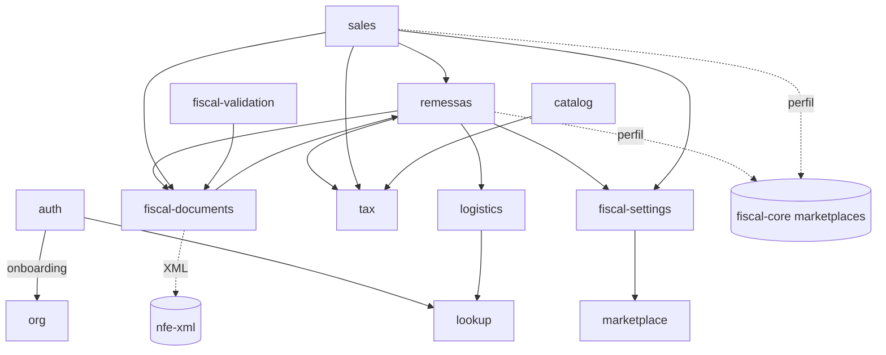
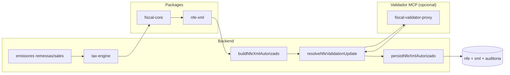
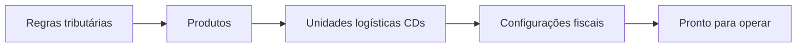
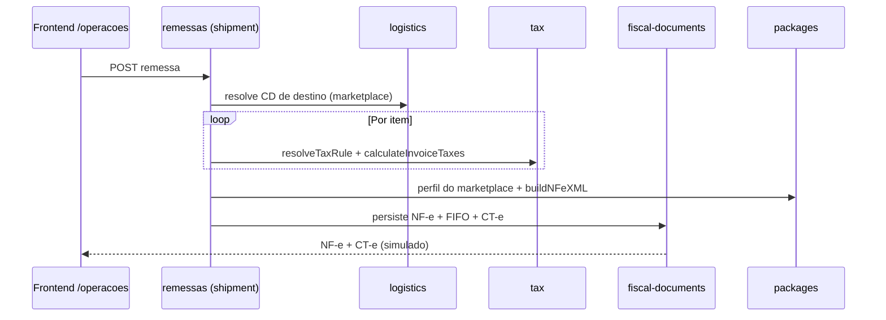
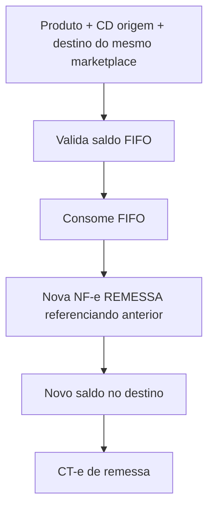
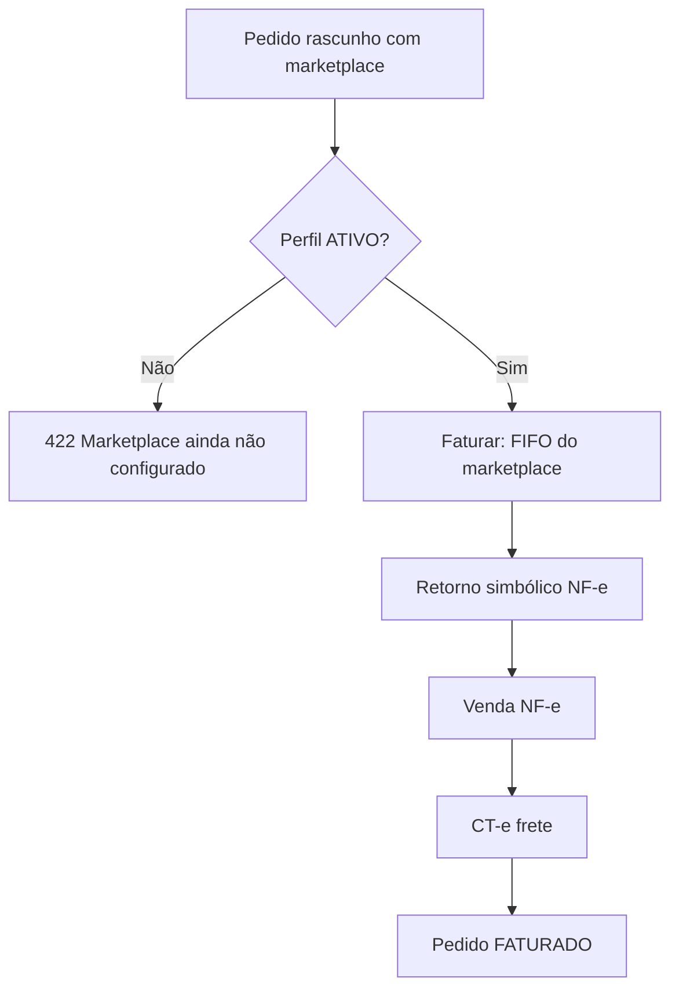
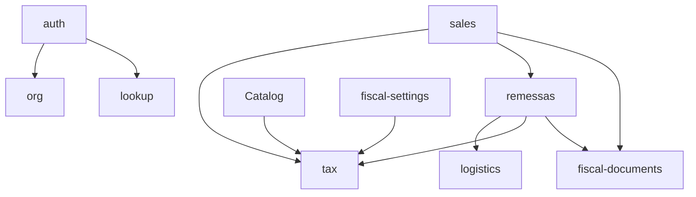
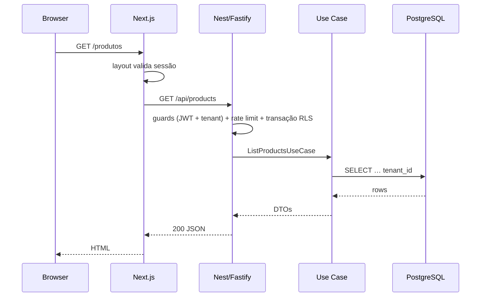
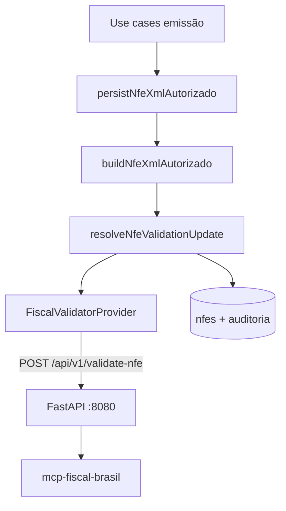

# Backend — MSimulation XML

API REST em **NestJS (sobre Fastify) + TypeScript + Prisma + PostgreSQL** que sustenta o simulador fiscal de fulfillment multi-marketplace (Mercado Livre ativo; Shopee, Amazon e Magalu preparados).

> **Contexto do produto:** simulador educacional. XMLs usam homologação (`tpAmb=2`), assinaturas fictícias e **não têm validade** perante a SEFAZ.

---

## Índice

1. [Stack e execução local](#stack-e-execução-local)
2. [Visão geral da arquitetura](#visão-geral-da-arquitetura)
3. [Feature modules](#feature-modules)
4. [Marketplaces](#marketplaces)
5. [Bounded contexts (`src/modules/`)](#bounded-contexts-srcmodules)
6. [Diagrama de arquitetura](#diagrama-de-arquitetura)
7. [Bootstrap e registo de rotas](#bootstrap-e-registo-de-rotas)
8. [Estrutura de pastas](#estrutura-de-pastas)
9. [Comunicação entre módulos](#comunicação-entre-módulos)
10. [Padrões e convenções](#padrões-e-convenções)
11. [Packages compartilhados](#packages-compartilhados)
12. [Fluxos de negócio](#fluxos-de-negócio)
13. [Fluxo HTTP](#fluxo-http)
14. [Validador MCP](#validador-mcp)
15. [Problemas comuns](#problemas-comuns)
16. [Testes e scripts](#testes-e-scripts)
17. [Documentação por módulo](#documentação-por-módulo)

---

## Stack e execução local

| Tecnologia | Uso |
|------------|-----|
| **NestJS 11** | Controllers, guards, interceptors, filtros e DI (`@nestjs/platform-fastify`) |
| **Fastify 5** | Servidor HTTP por baixo do Nest; plugins de borda (helmet, CORS, rate limit, multipart) |
| **TypeScript** | Tipagem estrita; decorators experimentais, sem metadata emitida (DI com `@Inject` explícito) |
| **Zod** | Validação HTTP (`<feature>/dtos/`), via `ZodValidationPipe` |
| **Prisma 7** | ORM + migrations PostgreSQL |
| **@fastify/jwt** | Access / refresh tokens (injetado no Nest pelo token `JWT`) |
| **Brevo** | E-mails transacionais |
| **otplib** | 2FA TOTP |

```bash
# Na raiz do monorepo
pnpm install
cp .env.example .env
cp backend/.env.example backend/.env
pnpm db:setup
pnpm dev
```

| Serviço | URL |
|---------|-----|
| API | http://localhost:3001 |
| Health | http://localhost:3001/api/health |

Variáveis obrigatórias: `DATABASE_URL`, `JWT_SECRET`, `PASSWORD_PEPPER`, `CORS_ORIGINS`, `APP_PUBLIC_URL`. Ver [`backend/.env.example`](./.env.example).

---

## Visão geral da arquitetura

O backend é um **monolito modular NestJS**. Cada contexto de negócio é um `@Module` em `src/modules/<contexto>/`, dividido em **features** (uma pasta por agregado ou fluxo). Não há mais as camadas `domain/`, `application/`, `infrastructure/` e `presentation/`: a pasta da feature junta controller, service, use cases, repository, DTOs e regras.

| Peça | Responsabilidade |
|------|------------------|
| `<feature>.controller.ts` | Traduz HTTP: valida com `ZodValidationPipe`, lê `@TenantId()`, chama service ou use case |
| `<feature>.service.ts` | Operações simples do agregado (listar, buscar, criar rascunho) |
| `use-cases/<feature>-<ação>.usecase.ts` | Fluxo que cruza services, providers ou regras; um método `execute` |
| `<feature>.repository.ts` | Único acesso ao Prisma, via `getDbClient()` (transação com RLS) |
| `dtos/<x>.request.dto.ts` | Schema Zod + tipo inferido |
| `rules/` | Regra pura do app (sem Nest); verificado pelo [`src/test/architecture.spec.ts`](./src/test/architecture.spec.ts) e pela regra `rules-no-nest-layer` do `.dependency-cruiser.js` |
| `types/` | Tipos da feature |
| `adapters/<marketplace>/` | O que muda por marketplace dentro da feature (ex.: planilha de CDs do ML) |
| `test/` | Specs Vitest ao lado do que testam |

A injeção é sempre `@Inject(Classe)` explícito: o build não emite metadata de decorators.

---

## Feature modules

Fluxo típico de uma requisição autenticada:

```
HTTP Request
    │
    ▼
Fastify (helmet, CORS, parser de corpo, multipart)
    │
    ▼
Nest: guards (JWT, empresa, e-mail, ADMIN) → RateLimitInterceptor → DbContextInterceptor (transação + RLS)
    │
    ▼
<feature>.controller.ts     ← ZodValidationPipe, @TenantId(), status HTTP
    │
    ▼
service / use case          ← regra de negócio; perfil do marketplace quando a nota depende dele
    │
    ▼
<feature>.repository.ts     ← getDbClient().<model>
    │
    ▼
PostgreSQL (+ RLS por tenant)
```

Exemplo (`sales`):

```
modules/sales/
├── sales.module.ts
├── index.ts                       # API pública: erros de domínio
├── errors/                        # sales.errors.ts + filtro das rotas
├── order/                         # /pedidos (rascunho, edição, integração)
│   ├── order.controller.ts
│   ├── order.service.ts
│   ├── order.repository.ts
│   ├── dtos/order.request.dto.ts
│   ├── rules/                     # id do pedido pelo perfil do marketplace, frete
│   └── test/
└── invoicing/                     # /pedidos/:id/faturar, /pedidos/checkout
    ├── invoicing.controller.ts
    ├── use-cases/
    ├── sales-chain/               # retorno simbólico → venda → CT-e
    ├── rules/
    └── test/
```

---

## Marketplaces

O sistema fatura para **Mercado Livre, Shopee, Amazon e Magalu**. O que muda por marketplace no XML fica no `fiscal-core`, uma pasta por marketplace em [`packages/fiscal-core/src/marketplaces/`](../packages/fiscal-core/src/marketplaces/): intermediador, responsável técnico, autXML padrão, transportador, IBS/CBS padrão, campos do `<ide>`, formato do id do pedido e os blocos do `fiscalPayload` de remessa e venda.

- O backend nunca compara o código do marketplace: pede o perfil ao registry (`getMarketplaceProfile` / `getBillableMarketplaceProfile`) e usa os campos dele.
- Perfil com status `PENDENTE_CONFIGURACAO` (Shopee, Amazon e Magalu hoje): o pedido pode ser criado como rascunho, mas faturar responde **422 "Marketplace ainda não configurado para faturamento"**.
- **De onde vem o marketplace de cada nota:**
  - remessa, avanço e transferência: do CD de destino (`unidades_logisticas.marketplace`);
  - venda e retorno simbólico: do pedido;
  - devolução, retorno físico e conferência: da nota de origem.
- **Configuração do faturador:** `loadEmitterSettings(db, tenantId, marketplace)` junta o padrão da empresa (`fiscal_emitter_settings`) com a sobrescrita do marketplace (`marketplace_billing_settings`). Na API: `GET/PUT /api/fiscal-settings/marketplaces/:marketplace`.
- **Estoque FIFO:** a venda consome só remessas do marketplace do pedido.
- **Id do pedido:** `MarketplaceFiscalProfile.pedido` valida e gera (ML: só dígitos).

Para ativar um marketplace:
1. Coloque XMLs reais em `XMLs/marketplaces/<marketplace>/` (pasta fora do git).
2. Preencha a pasta do marketplace no `fiscal-core`, seguindo o checklist do `README.md` dela.
3. Mude o status do perfil para `ATIVO` e adicione o cenário golden no `nfe-xml`.

---

## Bounded contexts (`src/modules/`)

| Módulo | Features | Responsabilidade |
|--------|----------|------------------|
| [**auth**](./src/modules/auth/) | session, registration, two-factor, password-reset, email-verification, onboarding, user | Login, refresh, registro, 2FA TOTP, verificação de e-mail, onboarding |
| [**org**](./src/modules/org/) | tenant, filial, member, emitente-fiscal | Empresas, filiais, membros e papéis do emitente |
| [**catalog**](./src/modules/catalog/) | product, product-import | Produtos e importação por planilha |
| [**tax**](./src/modules/tax/) | tax-rule, tax-calculation | Regras tributárias e motor de cálculo |
| [**marketplace**](./src/modules/marketplace/) | — | `GET /api/marketplaces` e o schema Zod do código de marketplace |
| [**fiscal-settings**](./src/modules/fiscal-settings/) | emitter-settings, marketplace-billing-settings, billing-settings | Padrão do faturador, sobrescrita por marketplace e configuração efetiva |
| [**logistics**](./src/modules/logistics/) | logistics-unit, product-movement | CDs por marketplace (planilha do ML em `adapters/mercado-livre/`) e histórico de movimentações |
| [**remessas**](./src/modules/remessas/) | shipment, branch-transfer, warehouse-advance, stock-fifo, symbolic-shipment, fiscal-chain | Remessa física, transferência entre filiais, avanço entre CDs, saldo FIFO |
| [**sales**](./src/modules/sales/) | order, invoicing | Pedidos com marketplace e cadeia de venda |
| [**fiscal-documents**](./src/modules/fiscal-documents/) | nfe, cte, cancellation, document-return, inbound-conference, number-inutilization, observability | Consulta e XML de NF-e/CT-e, ciclo de vida da NF-e, timeline |
| [**fiscal-validation**](./src/modules/fiscal-validation/) | nfe-validation, insights, validator-status | Validação MCP das NF-es (pós-commit e backfill) |
| [**lookup**](./src/modules/lookup/) | — | CNPJ e CEP (BrasilAPI / OpenCNPJ / ViaCEP), com rate limit |
| [**health**](./src/modules/health/) | — | `/api/health` |

---

## Diagrama de arquitetura

### Módulos e dependências de negócio



`remessas` e `fiscal-documents` se usam pelos `index.ts` de cada um. O `index.ts` do remessas exporta só funções, tipos e erros (nenhuma classe Nest), para não fechar ciclo com o logistics.

---

## Bootstrap e registo de rotas

[`src/app.ts`](./src/app.ts) monta a instância Fastify (helmet, CORS, `@fastify/rate-limit` sem limite global, multipart de 15 MB, Prisma, `@fastify/jwt`), entrega ao `FastifyAdapter` e sobe o [`AppModule`](./src/nest/app.module.ts) com prefixo global `/api`. [`src/index.ts`](./src/index.ts) só escuta a porta.

O acesso é declarado no controller ([`src/nest/api-access.decorators.ts`](./src/nest/api-access.decorators.ts)):

| Escopo | Decorator | Autenticação |
|--------|-----------|--------------|
| `/api/health` | nenhum | Público |
| `/api/auth/*` | `@UseGuards(JwtAuthGuard)` por rota quando exige sessão; `@RateLimit(...)` por rota | Público / Bearer |
| `/api/lookup/*` | `@AuthenticatedApi()` + `@RateLimit(lookupRouteRateLimit)` | JWT, **sem** tenant; 30 req/min por rota e por IP (403 ao estourar) |
| `/api/*` (negócio) | `@ProtectedApi()` (+ `@AdminOnly()` por rota) | JWT + tenant + e-mail verificado; 300 req/min por IP compartilhadas |

Os módulos ficam listados em `FEATURE_MODULES` (`src/nest/app.module.ts`). As rotas de emissão `/movimentacoes/*` são do `remessas`; o `logistics` só tem `/unidades-logisticas` e `/movimentacoes-produto`.

Erros: o `ApiExceptionFilter` (global) mantém o contrato `{ error }` (400 Zod com `details`, 422 marketplace sem perfil fiscal, 503 banco indisponível, P2002 409, P2025 404, 5xx genérico). Mapeamentos de domínio por rota usam `@UseFilters(...)` com `RouteErrorFilter` (`mappings` ou `statusErrors`); auth e remessas têm filtros próprios.

---

## Estrutura de pastas

```
backend/
├── prisma/                    # Schema e migrations
├── scripts/                   # verify-marketplaces-migration.sh (só Postgres local)
├── src/
│   ├── index.ts               # Escuta a porta
│   ├── app.ts                 # buildApp(): Fastify + Nest
│   ├── config/                # ConfigService: único leitor de process.env
│   ├── nest/                  # Núcleo Nest: CoreModule, guards, interceptors, filtros, pipes, bases
│   ├── modules/
│   │   └── <contexto>/
│   │       ├── <contexto>.module.ts
│   │       ├── index.ts       # API pública para outros módulos
│   │       ├── errors/
│   │       └── <feature>/     # controller, service, repository, use-cases/, dtos/, rules/, types/, test/
│   ├── test/                  # Contrato HTTP (+ snapshot de rotas) e teste de arquitetura
│   ├── plugins/               # Plugins Fastify de borda: Prisma e @fastify/jwt
│   ├── lib/                   # Infraestrutura compartilhada sem Nest (db, auth, http)
│   └── generated/prisma/      # Client gerado
└── package.json
```

---

## Comunicação entre módulos

- **Pelo Nest:** o módulo que precisa importa o `@Module` do outro e injeta o provider exportado (ex.: `RemessasModule` importa `LogisticsModule` e recebe `LogisticsUnitService`).
- **Pelo `index.ts`:** funções, tipos e erros públicos de cada contexto. Imports entre módulos apontam para o `index.ts`, nunca para pastas internas. A exceção documentada no código é o `fiscal-settings`, que importa a regra de numeração direto, porque o index do `fiscal-documents` carrega o XML e fecharia um ciclo.
- **Ciclos de import:** barrados pela regra `no-circular` do dependency-cruiser (`pnpm depcheck`).
- **Inversão pontual:** o `fiscal-validation` define o tipo `NfeXmlContentResolver` (token `NFE_XML_CONTENT_RESOLVER`) e o `fiscal-documents` fornece a implementação.

---

## Padrões e convenções

| Tópico | Convenção |
|--------|-----------|
| Ficheiros / pastas | `kebab-case`; feature no singular |
| Use cases | `use-cases/<feature>-<ação>.usecase.ts`, classe `<Feature><Ação>UseCase`, método `execute` |
| Controllers | `<feature>.controller.ts` com `@Inject(Classe)` explícito |
| Status HTTP | `@HttpCode` em todo `POST` que não responde 201; 404 com `orNotFound(valor, mensagem)` |
| Erros de domínio | Classes em `errors/`, mapeadas por filtro de rota; marketplace pendente sobe como `MarketplaceNotConfiguredError` (422 global) |
| Validação HTTP | Zod em `<feature>/dtos/`, aplicado com `ZodValidationPipe`; marketplace com `marketplaceCodeSchema` |
| Marketplace | Nunca `if (marketplace === "...")`: use o perfil do `fiscal-core` |
| IDs multi-tenant | Sempre filtrar por `tenantId` do JWT (`@TenantId()`); RLS ativo via `@ProtectedApi()` |
| Mensagens de erro | Em português: o frontend mostra o texto direto |
| Transações | `runFiscalTransaction` / `runInTransaction` no use case ou emissor, nunca no controller |

Pacotes internos do monorepo: `@msimulation-xml/fiscal-core`, `@msimulation-xml/nfe-xml` — detalhe na secção [Packages compartilhados](#packages-compartilhados).

---

## Packages compartilhados

Pacotes TypeScript puros (sem DB), consumidos pelo backend e testáveis isoladamente. Pastas na raiz do monorepo: [`../packages/fiscal-core`](../packages/fiscal-core/), [`../packages/nfe-xml`](../packages/nfe-xml/).

### `@msimulation-xml/fiscal-core`

| Responsabilidade | Exemplos |
| ---------------- | -------- |
| Assinatura XML simulada | `buildSimulationXmlSignature`, `injectSimulationSignature` |
| Perfil fiscal por marketplace | `getMarketplaceProfile`, `getBillableMarketplaceProfile`, `profile.enrichFulfillmentPayload` / `enrichVendaPayload` |
| CT-e | `buildCteFiscalPayload`, `buildCTeXML` |
| Runtime do emissor | `buildEmitterSnapshot`, `calcTributoBase`, `resolveDifalMode` |
| ICMS interestadual | `resolveInterstateIcmsRateForProductOrigin` |

```bash
pnpm --filter @msimulation-xml/fiscal-core build
pnpm --filter @msimulation-xml/fiscal-core test
```

### `@msimulation-xml/nfe-xml`

| Responsabilidade | Exemplos |
| ---------------- | -------- |
| Montagem XML NF-e | `buildNFeXML`, `highlightXML` |
| Tags de imposto a partir do engine | `buildIcmsXmlFromEngineItem`, `icmsTotFromEngine` |
| Eventos | `buildProcEventoCancelamentoXML` |

Depende de `@msimulation-xml/fiscal-core`.

```bash
pnpm --filter @msimulation-xml/nfe-xml build
pnpm --filter @msimulation-xml/nfe-xml test
```

### Pipeline de geração de XML



---

## Fluxos de negócio

### Onboarding

```mermaid
flowchart TD
  A[Criar conta / Login] --> B{E-mail verificado?}
  B -->|Não| C[/login/verificar-email]
  B -->|Sim| D{Tenant cadastrado?}
  D -->|Não| E[/onboarding/empresa]
  E --> F[Consulta CNPJ via lookup]
  F --> G[Cria tenant + usuário ADMIN]
  G --> H[Dashboard]
  D -->|Sim| H
```

### Setup operacional (antes de emitir)



### Remessa física (envio ao CD)



### Avanço CD → CD



### Cadeia de venda



### Dependências entre módulos



---

## Fluxo HTTP



Mutações usam Server Actions no frontend com POST/PUT/DELETE na API.

---

## Validador MCP

Auditoria de XML NF-e **após** geração e **antes** de persistir — **não bloqueante**. Escopo v1: só NF-e (CT-e fora). Pacote: [mcp-fiscal-brasil](https://github.com/dehor-labs/mcp-fiscal-brasil). Proxy: [`../infra/fiscal-validator-proxy`](../infra/fiscal-validator-proxy/). Path ativo (`validate-nfe`) inclui tabelas MCP + regras CAT 31 / fulfillment / assinatura / alíquota ICMS.

### Comportamento

| Cenário | `statusValidacao` | Emissão abortada? |
| ------- | ----------------- | ----------------- |
| XML aprovado | `APPROVED` | Não |
| XML rejeitado | `REJECTED` | **Não** — só rastreio |
| `FISCAL_VALIDATOR_ENABLED=false` | `PENDING` | Não |
| MCP offline / timeout | `PENDING` | Não |

Choke point: `persistNfeXmlAutorizado` (`src/modules/fiscal-documents/nfe/xml/nfe-xml.service.ts`) grava `PENDING`; a validação roda depois do commit pelo `NfeValidationBackfillUseCase`.

### Env (placeholders — ver [`.env.example`](./.env.example))

| Variável | Default dev | Descrição |
| -------- | ----------- | --------- |
| `FISCAL_VALIDATOR_URL` | `http://localhost:8080` | Base do proxy |
| `FISCAL_VALIDATOR_ENABLED` | `true` | `false` / `0` pula MCP |

Raiz do monorepo: `FISCAL_VALIDATOR_PORT` em [`../.env.example`](../.env.example).

### Docker local

```bash
# Na raiz do monorepo
pnpm docker:up
curl -sf http://localhost:8080/health
```

Imagem: [`../Dockerfile.fiscal-validator`](../Dockerfile.fiscal-validator). Deploy: [`../render.yaml`](../render.yaml).

### API de observabilidade

| Método | Rota | Auth |
| ------ | ---- | ---- |
| `GET` | `/api/fiscal-validation/status` | JWT + tenant |
| `GET` | `/api/fiscal-validation/insights` | JWT + tenant |
| `POST` | `/api/fiscal-validation/backfill` | JWT + tenant + ADMIN |

O browser **nunca** chama o MCP — só o backend.

### Arquitetura (resumo)



---

## Problemas comuns

| Sintoma | Causa provável | Solução |
| ------- | -------------- | ------- |
| `ECONNREFUSED :5432` | Postgres parado | `pnpm docker:up` (raiz) |
| API 401 em tudo | JWT / `JWT_SECRET` mudou | Relogar; confira `.env` |
| Migration falha | Banco desatualizado | `pnpm --filter @msimulation-xml/backend exec prisma migrate deploy` |
| Build falha em packages | `dist/` velho | `pnpm --filter @msimulation-xml/fiscal-core build && pnpm --filter @msimulation-xml/nfe-xml build` |
| CORS no browser | Origem não listada | `CORS_ORIGINS=http://localhost:3000` |
| NF-es sempre `PENDING` | MCP offline | `pnpm docker:up` ou `FISCAL_VALIDATOR_ENABLED=false` |
| Badge rejeitado | XML reprovado (esperado) | Detalhe NF-e → painel de auditoria |

---

## Testes e scripts

```bash
# Testes (Vitest, *.spec.ts; compila pacotes fiscais antes). Inclui o contrato HTTP em src/test/.
pnpm --filter @msimulation-xml/backend test

# Mudança intencional de rota: regravar o snapshot do contrato
UPDATE_CONTRACT_SNAPSHOT=1 pnpm --filter @msimulation-xml/backend test

# Typecheck
pnpm --filter @msimulation-xml/backend exec tsc --noEmit

# Migrations: valide sempre num Postgres local antes de produção
POSTGRES_PORT=5433 bash backend/scripts/verify-marketplaces-migration.sh   # na raiz

# Prisma
pnpm --filter @msimulation-xml/backend exec prisma migrate dev
pnpm --filter @msimulation-xml/backend exec prisma studio
```

---

## Documentação por módulo

Cada bounded context deve ter o seu `README.md` com overview, diagrama de sequência do caso de uso principal e lista de entidades (regra **02-backend-documentation**). **Índice previsto** (ficheiros ainda não criados na maioria dos módulos):

| Módulo | Pasta alvo |
|--------|------------|
| auth | `src/modules/auth/README.md` |
| org | `src/modules/org/README.md` |
| catalog | `src/modules/catalog/README.md` |
| tax | `src/modules/tax/README.md` |
| logistics | `src/modules/logistics/README.md` |
| remessas | `src/modules/remessas/README.md` |
| sales | `src/modules/sales/README.md` |
| fiscal-documents | `src/modules/fiscal-documents/README.md` (há nota em `observability/README.md`) |
| fiscal-settings | `src/modules/fiscal-settings/README.md` |
| lookup | `src/modules/lookup/README.md` |
| health | `src/modules/health/README.md` |

Documentação complementar:

| Documento | Conteúdo |
| --------- | -------- |
| [`../README.md`](../README.md) | Portal do monorepo |
| [`../CONTRIBUTING.md`](../CONTRIBUTING.md) | Como contribuir |
| [`docs/fiscal/regras-fulfillment-cat31.md`](./docs/fiscal/regras-fulfillment-cat31.md) | Portaria CAT 31 / ML Full |
| [`docs/fiscal/manual-nfe-moc.md`](./docs/fiscal/manual-nfe-moc.md) | Referência estrutural NF-e (MOC) |
| [`../frontend/README.md`](../frontend/README.md) | Thin client Next.js |
